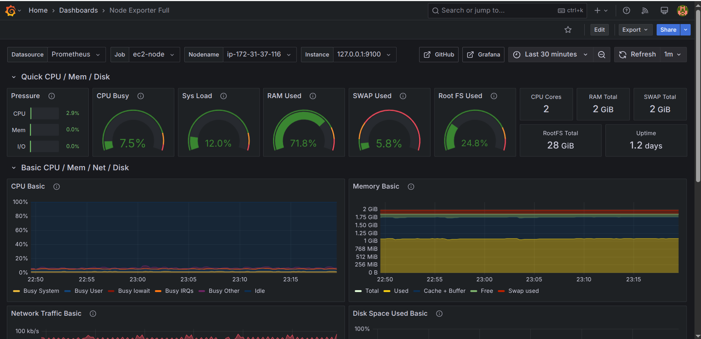

# Dhaba DevOps Platform

An end-to-end DevOps engineering portfolio project that takes a
microservices-based restaurant ordering application from source code
to containerized, continuously delivered and monitored Kubernetes
environments.

## Project

Dhaba DevOps Platform demonstrates the design, implementation,
deployment and operation of a Kubernetes-based microservices
platform using modern DevOps practices.
The platform demonstrates automated testing, containerization,
AWS image publishing, Kubernetes orchestration, continuous delivery,
persistent storage, monitoring, incident response and rollback.

## Application Services

| Service | Technology | Responsibility |
|---|---|---|
| web | React / Vite / Nginx | Ordering interface, kitchen screen and statistics |
| menu-api | Python / FastAPI | Menu management and caching |
| orders-api | Go | Order processing |
| kitchen-worker | Java / Spring Boot | Background order processing |
| stats-api | PHP / Laravel | Restaurant statistics |
| postgres | PostgreSQL | Persistent application data |
| redis | Redis | Cache and background job queue |

An additional `ops-monitor` image runs operational monitoring scripts.

## Technology Stack

- Linux and Bash
- Git and GitHub
- Docker and Docker Compose
- AWS EC2 and Elastic Container Registry (ECR)
- Kubernetes and Kustomize
- GitHub Actions
- PostgreSQL and Redis
- Python, Go, Java, PHP and JavaScript
- ShellCheck, Hadolint, Trivy and other testing tools
- Prometheus and Grafana where applicable

## Platform Architecture

The intended platform includes:

- Separate staging and production Kubernetes namespaces
- Container images tagged with Git commit SHAs
- Automated CI checks and unit tests
- AWS ECR image publishing
- Automated staging deployments
- Controlled production releases
- Kubernetes persistent volumes for PostgreSQL and Redis
- Deployment rollback and smoke testing
- Shell-based cluster, service and database monitoring
- Kubernetes Job logs for monitoring reports

## Repository Structure

```text
.
├── .github/workflows/
├── db/
├── dev/
├── k8s/
│   ├── base/
│   ├── overlays/
│   │   ├── staging/
│   │   └── production/
│   └── ops/
├── kitchen-worker/
├── menu-api/
├── ops-monitor/
├── orders-api/
├── scripts/
│   └── monitor/
├── stats-api/
└── web/
```


## Infrastructure Monitoring and Observability

The Dhaba DevOps Platform includes EC2 infrastructure monitoring using Prometheus, Node Exporter and Grafana.

### Monitoring Architecture

- **Node Exporter:** Runs on the AWS EC2 instance and collects CPU, memory, swap, filesystem, network, disk I/O and uptime metrics.
- **SSH Tunnel:** Securely forwards the Node Exporter endpoint to the Ubuntu monitoring environment. Port 9100 is not publicly exposed.
- **Prometheus:** Runs locally on Ubuntu and scrapes EC2 metrics every 15 seconds.
- **Grafana:** Runs locally on Ubuntu and visualizes metrics collected by Prometheus.

```text
AWS EC2
  |
  v
Node Exporter :9100
  |
  v
SSH Tunnel
  |
  v
Ubuntu Laptop
  |
  v
Prometheus :9090
  |
  v
Grafana :3000
  |
  v
Dhaba Infrastructure Monitoring Dashboard
```

### Dashboard Preview

The dashboard provides visibility into:

- EC2 availability and uptime
- CPU utilization and per-core activity
- Memory and swap usage
- Filesystem capacity
- Network traffic
- Disk read/write activity
- System load averages



### Dashboard Configuration

The exported Grafana dashboard contains 28 elements, including 15 visualization panels and 13 row containers.

The dashboard JSON is available at:

`monitoring/grafana/dhaba-infrastructure-dashboard.json`

It can be imported into another Grafana installation by configuring the Prometheus datasource and selecting the appropriate job and instance.

### Dashboard Preview

The dashboard provides visibility into:

- EC2 availability and uptime
- CPU utilization and per-core activity
- Memory and swap usage
- Filesystem capacity
- Network traffic
- Disk read/write activity
- System load averages


### Dashboard Configuration

The exported Grafana dashboard contains 28 elements, including 15 visualization panels and 13 row containers.

The dashboard JSON is available at:

`monitoring/grafana/dhaba-infrastructure-dashboard.json`

It can be imported into another Grafana installation by configuring the Prometheus datasource and selecting the appropriate job and instance.
## Project Status

The application has been deployed to an AWS EC2-hosted K3s cluster. The public frontend is accessible through NodePort 30080, while backend APIs and data services remain private within the cluster.

GitHub Actions workflows run CI checks and publish container images to Amazon ECR. Automated deployment through these workflows is not currently implemented.

EC2 infrastructure monitoring is implemented using Node Exporter, Prometheus and Grafana. The Grafana dashboard configuration and screenshot are maintained in this repository.

Further work includes expanding deployment automation, validating additional operational monitoring workflows and improving the platform's production readiness.

## Security Principles

- No AWS access keys or private credentials in Git.
- GitHub Actions should use short-lived AWS credentials through OIDC
  where supported.
- Kubernetes credentials remain outside the repository.
- Application passwords and deployment credentials are stored securely.
- Production changes should follow the documented delivery workflow.

## License

To be decided.
