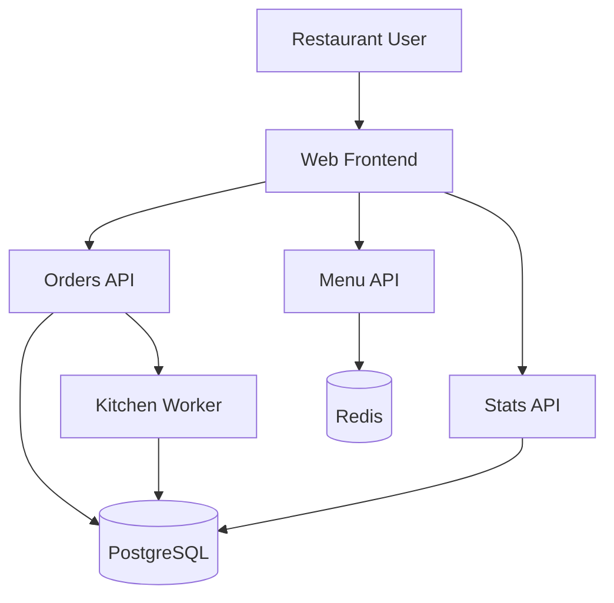
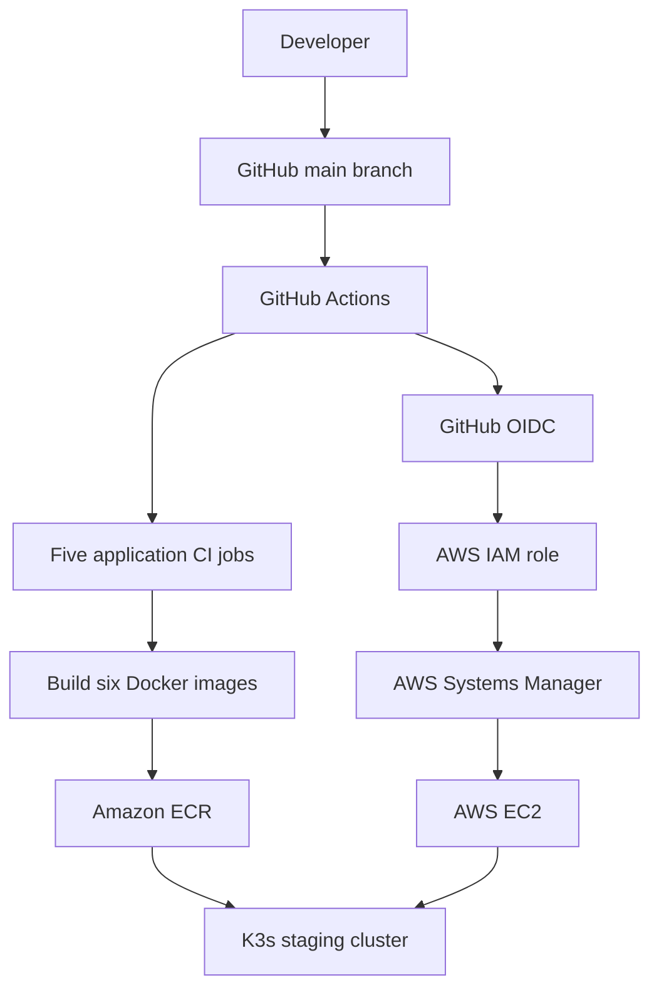
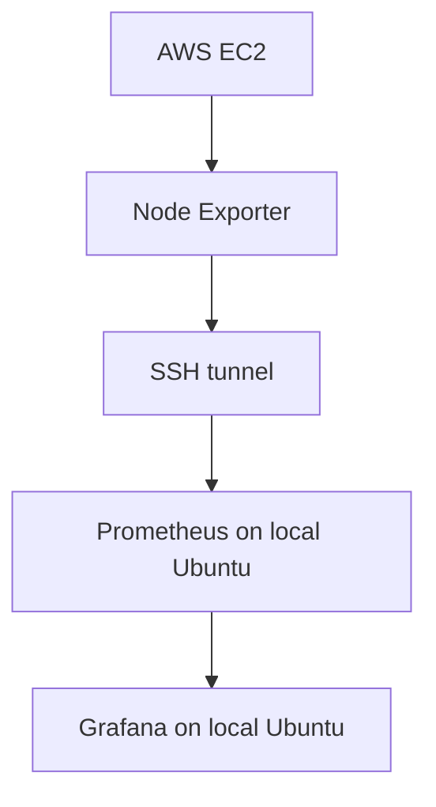

# Dhaba DevOps Platform — Architecture

## Overview

Dhaba is a microservices-based restaurant application deployed to a K3s cluster hosted on AWS EC2. The platform combines application delivery, CI/CD automation, and infrastructure monitoring.

## Application Architecture

| Component | Responsibility |
|---|---|
| web | Restaurant user interface |
| menu-api | Menu operations |
| orders-api | Order processing |
| kitchen-worker | Background order processing |
| stats-api | Restaurant statistics |
| PostgreSQL | Persistent application data |
| Redis | Caching and background job support |

## CI/CD Architecture

The workflow runs five application CI jobs, builds and publishes six images, authenticates to AWS through OIDC, and uses Systems Manager to run deployment commands on EC2. It updates five application Deployments using commit-SHA image tags and waits for rollout completion. The `ops-monitor` image is published but is not part of the five-service application deployment.

## Kubernetes and Network Design

- K3s runs on AWS EC2.
- Application workloads run in the `staging` namespace.
- The frontend is exposed through NodePort `30080`.
- Backend APIs use internal Kubernetes networking.
- PostgreSQL and Redis remain private cluster services.
- Images are pulled from private Amazon ECR repositories.

## Monitoring Architecture

Node Exporter exposes host metrics on EC2. An SSH tunnel provides secure access from the local Ubuntu environment, where Prometheus collects metrics and Grafana visualizes them.

Dashboard configuration: `monitoring/grafana/dhaba-infrastructure-dashboard.json`

## Image Versioning

Application images use Git commit SHA tags to provide traceability between source code and deployed versions. The staging Kustomize overlay records the current image references. The GitHub Actions deployment workflow updates Deployments directly using Kubernetes commands; it does not automatically apply the Kustomize overlay.

## Security Boundaries

- GitHub Actions authenticates to AWS using OIDC short-lived credentials.
- AWS Systems Manager provides remote command execution.
- The frontend is the public application entry point.
- Backend, database, and Redis services remain internal.
- Node Exporter monitoring access uses SSH tunnelling.
